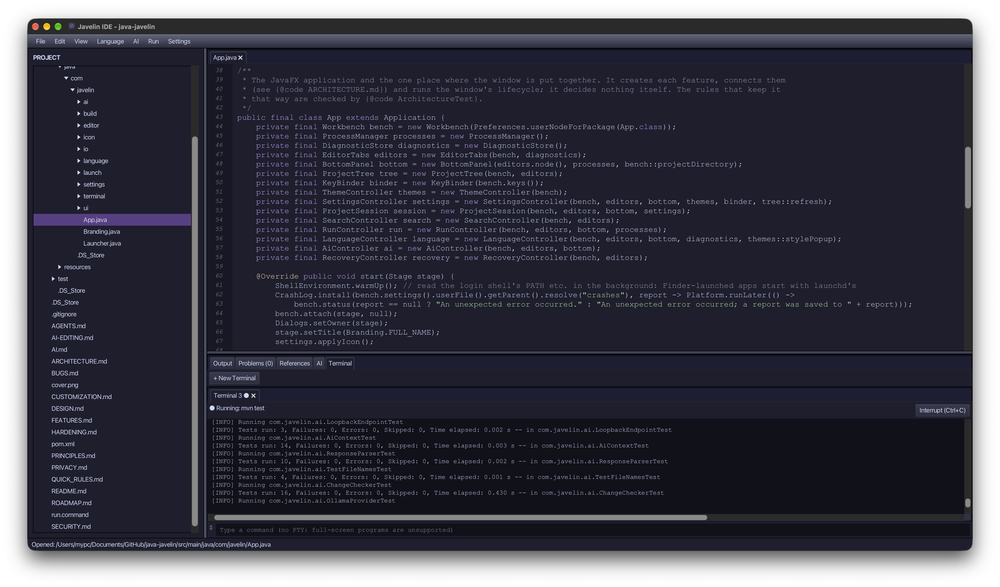

# Javelin IDE

**A local-first Java IDE for focused, human-directed software development.**



Javelin is a desktop code editor built around a simple idea: software development tools should help you work on your projects without becoming a platform you have to depend on. Your projects remain ordinary files on your computer. Editing works offline, there is no account to create, and commands and AI assistance run only when you choose them.

## What you can do

- **Edit and navigate code:** Work with multiple files and tabs, syntax highlighting for common programming and markup languages, search and replace, bracket matching, indentation, and line navigation.
- **Work with projects:** Browse and manage project files, open recent projects, find files by name, and recover unsaved tabs after a crash. File deletion goes to the system Trash or Recycle Bin.
- **Build and run:** Build projects using detected Maven, Gradle, Make, Cargo, or npm commands. Run a command you review first, inspect output and compiler problems, and manage processes from the editor.
- **Use an integrated terminal:** Keep terminal sessions in tabs alongside your editor and project output.
- **Add language intelligence:** Start a language server when you want features such as diagnostics, completion, hover, go to definition, references, rename, and formatting. Javelin does not bundle language servers.
- **Use optional local AI:** Connect to Ollama on your own computer to explain or debug a selection, generate tests, or propose a code change. Requests require your approval, and proposed edits are shown for review before you apply them.
- **Make it yours:** Configure themes, keybindings, editor preferences, and project settings using readable text files.

Javelin does not include a built-in Git interface; use Git and your preferred Git tools as usual. See [FEATURES.md](FEATURES.md) for the complete feature list and its verification.

## Privacy and control

Javelin is designed to work offline without accounts, telemetry, cloud sync, or remote project storage. The optional AI integration communicates only with an Ollama service on the same computer. Language servers are started by you; their behavior and any network access they initiate depend on the server you choose.

AI is off unless you select an AI command. Before a request, Javelin shows the model, destination, scope, and full message. It does not apply proposed changes automatically. Read [PRIVACY.md](PRIVACY.md) and [AI.md](AI.md) for details.

## Get started

### Requirements

- Java 25+
- Maven 3.9 or newer

### Run from source

```bash
git clone https://github.com/arsjobus/java-javelin.git
cd java-javelin
mvn javafx:run
```

To open a project, use **File > Open Project**. To build the application artifacts, run:

```bash
mvn clean package
```

### Download a release

Download the latest available installers from [GitHub Releases](https://github.com/arsjobus/java-javelin/releases). Release automation produces a macOS DMG and a Windows MSI for version tags. The macOS app is currently unsigned and not notarized, so macOS may display a Gatekeeper warning.

### Install on macOS from source

With Java 25+ and Maven installed, build and install the app bundle and the `Javelin` terminal command:

```bash
packaging/macos/build-app.sh
packaging/macos/install.sh
```

Then open the current directory or a specified project:

```bash
Javelin
Javelin ~/code/my-project
```

The install script also supports `--uninstall`. See the script or [FEATURES.md](FEATURES.md) for installation details and options.

## Optional integrations

### Language servers

Javelin provides the Language Server Protocol client; language servers are installed separately and started explicitly from the **Language** menu. Their setup commands and required runtimes depend on the server. Review project-provided commands before running them.

### Local AI with Ollama

Install [Ollama](https://ollama.com) and download a model, for example:

```bash
ollama pull <model>
```

Then choose **AI > Choose Model...** in Javelin. AI features remain unavailable until you configure a local model. Javelin refuses non-local Ollama addresses; external AI providers are not supported. See [AI.md](AI.md) for usage and safeguards.

## Configuration

Settings are stored in readable `settings.conf` files. User settings are kept in the operating system's standard application configuration location; optional project settings live in `.javelin-ide/settings.conf` inside a project. Settings cover themes, shortcuts, editor preferences, commands, and more.

See [CUSTOMIZATION.md](CUSTOMIZATION.md) for settings, built-in themes, custom themes, and keybindings.

## Project documentation

| Document | Description |
| --- | --- |
| [FEATURES.md](FEATURES.md) | Current features, usage notes, and the tests that verify them |
| [PRINCIPLES.md](PRINCIPLES.md) | Product goals and design principles |
| [QUICK_RULES.md](QUICK_RULES.md) | Short rules for product and architecture decisions |
| [ARCHITECTURE.md](ARCHITECTURE.md) | Application layers, package boundaries, and technology choices |
| [CUSTOMIZATION.md](CUSTOMIZATION.md) | Settings, themes, and keybindings |
| [PRIVACY.md](PRIVACY.md) | Network behavior, privacy, and AI data handling |
| [AI.md](AI.md) | Local AI workflow and safeguards |
| [SECURITY.md](SECURITY.md) | Security notes |
| [ROADMAP.md](ROADMAP.md) | Project roadmap |

## Development

Javelin is a Java 25 and JavaFX desktop application built with Maven. Core editor, file, build, language, settings, and terminal behavior is kept separate from the JavaFX UI so it can be tested without opening a window.

Run the automated test suite with:

```bash
mvn test
```

To measure how reliably a local model edits code through the AI menu (needs Ollama running; see [docs/eval/README.md](docs/eval/README.md)):

```bash
mvn -Peval test -Deval.model=qwen3.5:9b
```

The JavaFX UI requires a graphical desktop session to launch and use.
